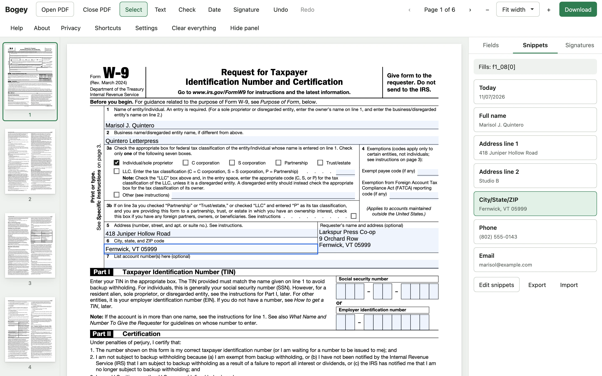
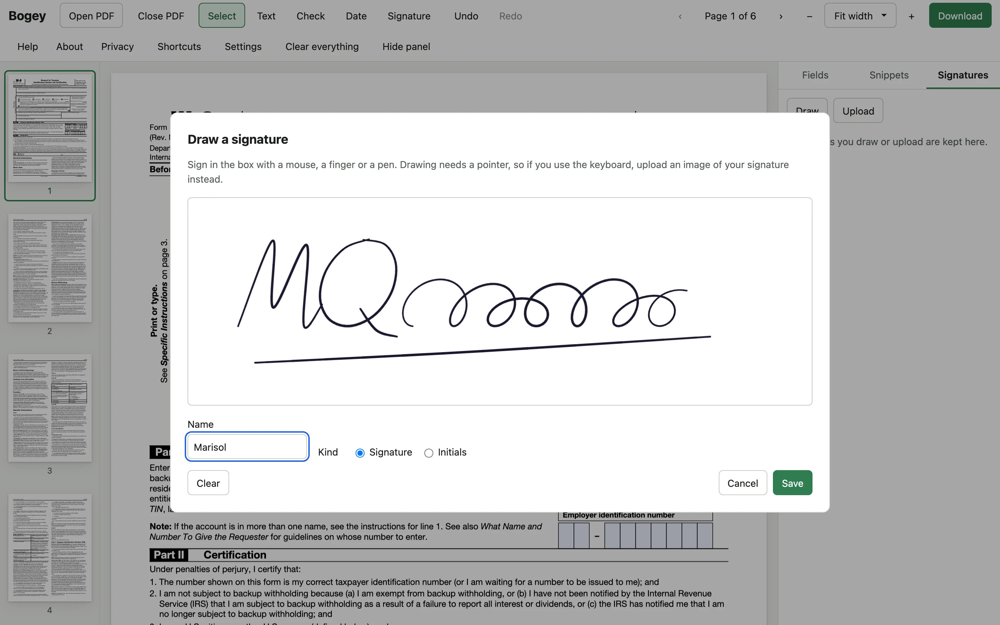
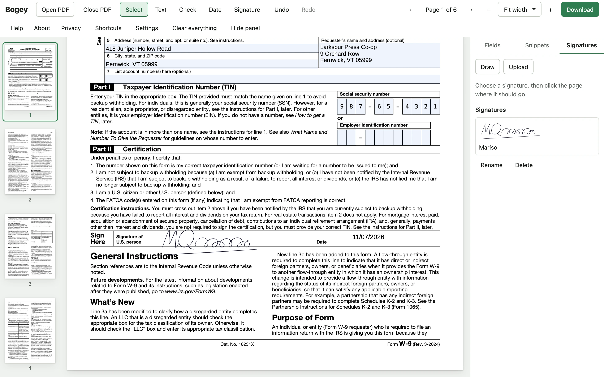
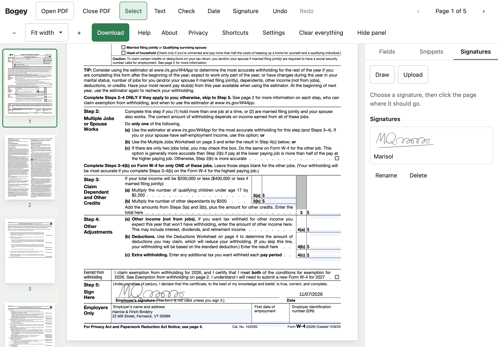

# Bogey

Bogey fills in and signs PDF forms in the browser. Most of the forms that arrive by email still need a signature and a few lines of typing, and the usual ways of doing that either mean installing a desktop reader, printing and scanning, or uploading the form, with whatever personal details are on it, to an online signing service. Bogey does the work locally instead: open a PDF, fill in its form fields or type onto a flat or scanned page, place a signature saved earlier, and download a flattened copy to send back. It runs on a Mac or PC browser and on an iPad with an Apple Pencil, and it works offline once it has loaded.

It is a companion to [Mulligan](../mulligan), built the same way and with the same security posture. The name follows Mulligan's: in golf, a bogey is a hole finished one stroke over par.

Bogey runs at <https://bogey.beta-site.us>. There are no accounts and nothing to install.

## Filling in a W-9

The screenshots here use the IRS Form W-9 and Form W-4, filled in for Marisol J. Quintero, who runs a letterpress shop in Vermont. She, her shop, her client and her employer are made up; her Social Security number, 987-65-4321, comes from the block the Social Security Administration reserves for advertising, her phone number is in the 555-01xx range set aside for fiction, and her email address is on a domain reserved for examples.



Opening the W-9 puts an HTML control over each of its fields, so typing into line 1 works the way typing into any web form does, and the checkbox for an individual or sole proprietor is a real checkbox. The Snippets panel on the right holds the details that go on most forms, saved once in the browser; with a field focused, clicking a snippet fills it, which is how lines 1, 5 and 6 were filled here. The panel names the field a snippet will fill, and since the IRS gives its fields internal names such as `f1_08[0]` and no labels, that is the name Bogey shows.



A signature is drawn once, with a mouse, a finger or an Apple Pencil, whose pressure sets the width of the line, or uploaded as a photo of a signature on paper, which Bogey separates from the paper. It is saved in the browser under a name and used again on every form after.



The Social Security number goes into the comb fields one digit per box. Placing the signature takes two clicks, one on the signature in the Signatures panel and one where it should go on the page, and pressing D and clicking puts today's date beside it. Download then writes the values, the signature and the date into the page, flattens the form so the recipient cannot change it, and saves `fw9-signed.pdf`.

## On an iPad



The same site runs on an iPad, where the toolbar wraps onto two rows and the Pencil draws signatures with pressure. This screenshot comes from Playwright's emulation of an 11-inch iPad Pro in WebKit; `docs/ipad-checklist.md` covers the checks made on a real one. The W-4's start date and employer identification number are left empty here because the form places those two fields across its own bottom rule, so anything typed into them sits on the page footer, in Acrobat as in Bogey.

## What it does

- **Opening.** Drop a PDF or choose it from the file picker, up to 50 MB and 2,000 pages, password-protected files included. The last 20 documents stay in a recent list, and a reload or a closed tab brings back the document, its page and zoom, and everything typed into it.
- **Form fields.** AcroForm fields get real HTML controls drawn over the page: text, multi-line, comb, checkboxes, radio buttons, dropdowns and lists, in the form's tab order across pages, with a Fields panel listing every field and its value. Adobe XFA forms are detected and explained; where an XFA form carries ordinary fields as well, those are filled.
- **Typing on the page.** Text, check marks and today's date can be placed anywhere, moved, resized, nudged with the arrow keys and undone. A placement from the keyboard goes where a focused marker shows.
- **Signatures.** Draw with a mouse, a finger or a Pencil (pressure sets the line width), or upload a photo of a signature on paper and let Bogey remove the paper. Signatures and initials are kept in a library and placed with a click.
- **Snippets.** Name, address, phone and email are saved once and dropped into a field or onto the page with one click, along with today's date; they export to and import from a JSON file.
- **The signed copy.** Export writes every value and overlay into the page, flattens the form so the recipient cannot change it, strips document JavaScript and other active content, removes any password, and checks the result before downloading it as `name-signed.pdf`.

## Privacy

There is no backend. The site is a set of static files in a private S3 bucket behind CloudFront, which accepts only `GET` and `HEAD` and keeps no access logs. Every response carries a Content Security Policy, defined once in `apps/web/security/headers.json`, that lets the page load only its own files and connect only to its own origin, with Trusted Types enforced and cross-origin isolation on; the application code makes no network calls of its own (ESLint bans them, and the only requests are pdf.js loading its fonts and decoders from the site and the service worker caching the build), and an end-to-end test fails on any request outside the build's own files. A document, a signature or a typed value has nowhere to go, and the Privacy page in the app shows how to check that in the browser's network tab.

What Bogey keeps, it keeps in the browser's IndexedDB on that device: documents (the original file, the values and overlays), signatures, snippets and settings. Documents untouched for 30 days are deleted. Passwords are never stored, and what is typed into a password-protected document is saved encrypted under a key derived from its password, so it cannot be read without it. Clear everything, in the toolbar and on the Privacy page, deletes the database and reports failure rather than success if the browser does not confirm it. The design and the threat model are in `docs/Bogey Technical Specification.md` §11.

## Documents

- `docs/VISION.md` and `docs/REQUIREMENTS.md`: what v1 had to do.
- `docs/Bogey Technical Specification.md`: how it is built, with every departure from the requirements in §16.
- `docs/Bogey Implementation Plan.md`: the sprints that built it, and the notes each wave left for the next.
- `docs/ipad-checklist.md` and `docs/manual-acceptance.md`: the checks a person makes on a Mac and an iPad.
- `CHANGELOG.md`: the releases.

## Structure

`packages/core` (`@bogey/core`) makes every decision about a document, with no DOM or pdf.js in it: geometry, inspection, edits and undo, signature pixel work, export and snippet import, built on `@cantoo/pdf-lib`. `apps/web` is the React application; it reaches core through `src/core-bridge/` and a worker, and uses pdf.js only to show pages. `fixtures/` holds the test PDFs, with every file's origin and license in `fixtures/LICENSES.md`.

## Local development

A pnpm workspace on Node 22 or later. The first time:

```bash
pnpm install
pnpm exec playwright install chromium firefox webkit
pnpm fixtures:fetch          # IRS, IRCC, qpdf and pdf.js test files, verified by SHA-256
brew install qpdf            # only to regenerate the encrypted fixture with pnpm fixtures:make
```

Day to day:

```bash
pnpm dev                     # dev server, with a relaxed CSP so hot reload works
pnpm build && pnpm preview   # the production build, served with the production headers
```

To regenerate the screenshots in `docs/images/` after a change to the interface, run `pnpm screenshots`. It needs the fetched IRS forms and `cwebp` (`brew install webp`), and it drives the production build through `tooling/screenshots/readme.shots.ts`.

The preview port comes from `scripts/ports.mjs`, which derives it from the checkout's path, so two worktrees can run at once.

## Tests

```bash
pnpm lint                    # ESLint, Prettier, dependency-cruiser, tsc and pnpm audit
pnpm test:coverage           # unit, component and Chromium browser tests, 80% coverage minimum
pnpm test:browsers           # the browser tests again in Firefox and WebKit
pnpm test:e2e                # Playwright against the production build (run pnpm build first)
pnpm gate                    # all of the above, then the build, in that order
```

Every Playwright test fails on any CSP or Trusted Types violation, so a change that would break the production policy fails in the test that exercises it. Chromium runs every end-to-end spec, and Firefox and WebKit run those tagged `@all-engines`, which include the accessibility scan (`e2e/a11y.spec.ts`) and the acceptance tests (`e2e/acceptance.spec.ts`). The expected-fail self-tests in `e2e/security.spec.ts` show as failures and count as passes.

## Deploying

The stack is `infra/bogey.yaml`: the bucket, the CloudFront distribution and its response headers policy, the certificate, DNS, a WAF rate rule and a budget alarm. Copy `deploy.env.example` to `deploy.env` and fill in the AWS profile and hosted zone, then:

```bash
pnpm infra:deploy            # create or update the CloudFormation stack
pnpm deploy:site             # gate, build master with its commit as the build id, publish, check live headers
```

Deploys run only from a clean `master`. The upload sends hashed assets with a one-year immutable cache and everything else, `sw.js` included, as `no-cache`, deletes stale files only after the new ones are in place, and finishes by checking every header on the live site, 304 responses included. Visitors' service workers pick up the new build on their next visit and offer a reload. If a bad build ever needs to be purged from visitors' caches, `CLAUDE.md` describes the service worker kill switch.

## License

Copyright © 2026 Tim Howland. GPL-3.0-or-later; see `LICENSE`. The overlay font is Liberation Sans, under the SIL Open Font License 1.1. pdf.js (Apache-2.0) shows the pages and `@cantoo/pdf-lib` (MIT) writes the copy.
